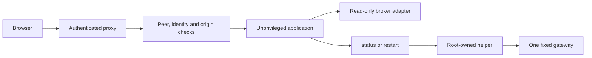

# Authenticated ingress and fixed-command service control

A personal financial-data application needed a browser button to restart one gateway and begin its normal login flow. Mounting a Docker socket into the web application would give that process authority over unrelated containers. The implementation instead exposes one fixed operation through a root-owned local helper, while keeping broker access read-only.

## Decisions at each boundary

| Decision | Concrete implementation | Reason |
|---|---|---|
| Make wider listening explicit | A non-loopback bind requires a configured trusted proxy and an HTTPS origin without credentials, path, query or fragment. | Loopback assumptions must not silently carry over to a wider listener. |
| Trust the transport peer first | Compare the accepted connection's TCP peer with the configured proxy address. Forwarded-address headers do not establish that trust. | A caller cannot become the trusted proxy by supplying a header. |
| Validate identity and browser origin together | Require a nonempty proxy-supplied identity and matching Host. Reject explicitly cross-site requests and any supplied Origin/Referer from another origin. | Authentication provenance and browser request context are separate requirements. |
| Normalize only after validation | Valid proxy requests are translated to the existing loopback Host/origin convention before downstream mutation and WebSocket checks. | Reuse the existing guard without allowing unvalidated requests to look local. |
| Give monitors a narrow exception | Configured monitor peers may use GET/HEAD on `/api/health` only. | Monitoring access must not imply access to financial data or mutations. |
| Remove trading capability from this adapter | Read-only broker access excludes preparing, transmitting or cancelling orders and execution processing. | A disabled UI control alone would not enforce this boundary. |
| Separate web and host authority | The web process can send only `status` or `restart` to a permission-controlled Unix socket. A root-owned helper controls one fixed target. | The request carries an operation, never a shell command or caller-selected container. |



The proxy must strip or replace client-supplied identity headers and enforce authentication. The application trusts that identity only from the configured peer. Loopback remains a deliberately trusted ingress path; local process compromise is outside the proxy identity guarantee.

The native guard obtains `ConnectInfo<SocketAddr>` from request extensions and fails closed when it is absent. Axum documents this as connection information supplied by the server's connection service, which must be wired explicitly. The guard compares that peer before considering proxy identity. This avoids using a forwarded client address as proof of who connected: RFC 7239 explicitly treats forwarded metadata as modifiable by clients and intermediaries. It still depends on the configured proxy and its connection path being trusted. [Axum connection-information contract](https://docs.rs/axum/latest/axum/extract/struct.ConnectInfo.html), [RFC 7239, header integrity](https://www.rfc-editor.org/rfc/rfc7239.html#section-8.1).

The origin comparison is structured rather than a string prefix: parse the supplied URL, derive its origin and compare its serialized form with the configured origin. An origin identifies scheme, host and port; a Referer's path is not part of it. Startup separately rejects credentials, query, fragment and non-root path in the configured public origin. These checks preserve the difference between a valid origin and an arbitrary URL that happens to begin similarly. They are browser-context checks, not replacement authentication. [RFC 6454, origin computation](https://www.rfc-editor.org/rfc/rfc6454.html#section-4), [URL crate origin API](https://docs.rs/url/latest/url/struct.Url.html#method.origin).

## Request decisions

The following matrix describes the ingress guard itself. Use `desk.example.test` as an illustrative configured HTTPS origin; all proxy rows assume a matching Host and nonempty authenticated identity unless the row changes them.

| Request | Ingress result | Explanation |
|---|---|---|
| Trusted proxy, POST `/api/chains`, matching Origin | Allowed onward | Peer, identity and browser origin agree; headers then normalize for downstream checks. |
| Different TCP peer, same headers | Rejected | Header values cannot replace the peer check. |
| Trusted proxy, identity header absent | Rejected | Proxy transport provenance alone is insufficient. |
| Trusted proxy, Host `other.example.test` | Rejected | Request authority must match the configured origin. |
| Trusted proxy, Origin or Referer from another origin | Rejected | Any supplied origin-bearing header must match. |
| Trusted proxy, explicit `Sec-Fetch-Site: cross-site` | Rejected | Explicit cross-site context fails even if other headers match. |
| Trusted proxy, no Origin or Referer | Allowed onward | These headers are checked when present; omission is not proof of a same-origin browser action. Downstream route policy still applies. |
| Configured monitor, GET or HEAD `/api/health` | Allowed onward | Exact method/path exception. |
| Configured monitor, GET `/api/fills` or POST `/api/chains` | Rejected | The exception does not extend to other routes or methods. |
| Missing connection peer information | Rejected | The policy cannot establish transport provenance. |
| Loopback peer | Allowed onward | Local callers retain the existing downstream policy. |

Existing synthetic ingress tests cover the proxy, missing-identity, wrong Host/origin/referrer, missing-peer and monitoring cases. The cross-site and absent-origin rows follow directly from the reviewed guard's branches.

## Fixed-command helper contract

The application exposes a same-origin, authenticated login-control endpoint. A restart is opt-in, requires read-only gateway mode and returns conflict before contacting the helper if the broker is already connected.

The local helper accepts one newline-terminated command per connection. Replies contain only a fixed state and cooldown seconds:

```text
status\n  → READY 0 | COOLDOWN <seconds> | BUSY 120 | ERROR 0
restart\n → OK 120  | COOLDOWN <seconds> | BUSY 120 | ERROR 0
```

The following pseudocode expresses the contract; it is not an extract of the private implementation:

```text
command = read_bounded_line(deadline = 5 seconds)
if command is neither "status" nor "restart":
    reply ERROR 0; stop

if exclusive_lock_cannot_be_acquired:
    reply BUSY 120; stop

remaining = clamp(last_attempt + 120 seconds - now, 0, 120)
if remaining > 0:
    reply COOLDOWN remaining; stop
if command == "status":
    reply READY 0; stop

persist last_attempt = now
restart FIXED_TARGET with a finite deadline
discard subprocess output
reply OK 120 on success, otherwise ERROR 0
```

The lock and timestamp live outside the web process. Concurrent tabs share the lock, and application restarts do not reset the cooldown. Persisting the timestamp before execution also makes failed or ambiguous attempts consume the cooldown. Unknown input never invokes container control.

The helper uses nonblocking exclusive `flock` on an open descriptor, so competing helper invocations return `BUSY` rather than executing together. Linux releases the lock when all corresponding descriptors close, including after process exit; the persistent timestamp carries the cooldown beyond that lock lifetime. `flock` is advisory, so it coordinates cooperating invocations—it is not an authorization check against a process that can rewrite the state. Root-owned state and the fixed command dispatcher supply separate boundaries. [Linux flock contract](https://man7.org/linux/man-pages/man2/flock.2.html).

The IPC endpoint is a pathname Unix stream socket. On Linux, connecting requires write permission on that socket; its directory, owner/group and mode therefore determine which local processes can reach the helper. This does not apply to abstract sockets, whose access is not controlled by pathname modes. A read-only directory mount must not be mistaken for denial of socket communication: systemd's filesystem-sandbox documentation explicitly distinguishes read-only paths from access to Unix sockets within them. Here the socket deliberately admits the application, while the two-command protocol limits the authority it receives. [Linux pathname-socket permissions](https://man7.org/linux/man-pages/man7/unix.7.html), [systemd filesystem/IPC distinction](https://github.com/systemd/systemd/blob/v258/man/systemd.exec.xml).

An accepted request continues if its browser connection closes. Cancellation therefore does not falsely imply that the restart was undone. `OK` means the restart command completed, not that broker authentication succeeded or a mobile push arrived. The user still confirms login through the broker's normal mechanism.

The existing helper harness substitutes a fake Docker executable. It checks that extra command arguments are rejected, simultaneous restarts produce one invocation, the target is fixed, and a failed attempt still starts the cooldown.

## Validation coverage

Source and existing synthetic checks were reviewed. Production proxy configuration, socket permissions and live broker state were not exercised.
